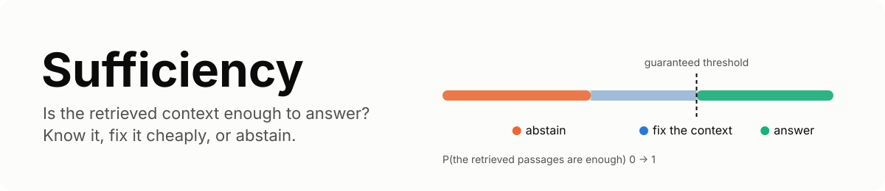
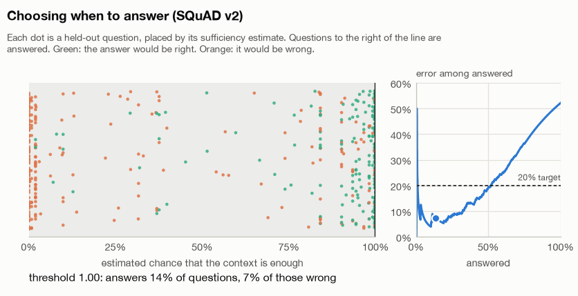
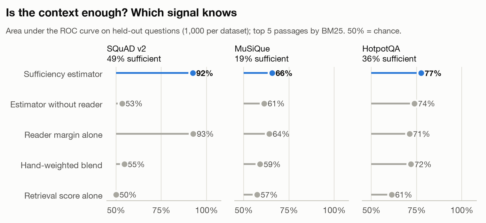
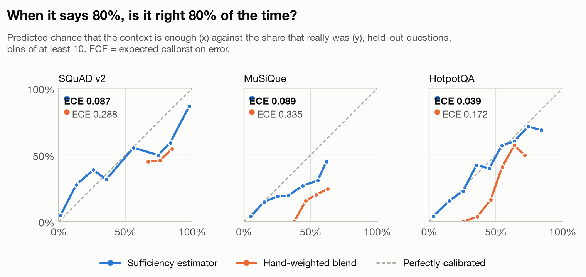

<picture>
  <source media="(prefers-color-scheme: dark)" srcset="docs/assets/banner-dark.svg">
  
</picture>

**Sufficiency decides, before a RAG system answers, whether the retrieved passages are
enough to answer the question. When they are not, it picks the fix most likely to work
for what it costs, and if nothing will, it abstains, with an error rate you can
guarantee in advance.**

A language model given passages that do not contain the answer usually answers anyway.
The answer reads as well as a grounded one, so nothing downstream can tell. The common
defences are a confidence score made of hand-weighted signals and a fixed cascade of
retries ("if confidence is low, rewrite the query"). Neither is measured: nobody knows
what the score's 0.7 means, or whether the retries help.

Sufficiency replaces each piece with something you can check:

1. **A calibrated estimate** that the context is enough, learned from labelled
   questions. When it says 0.8, about 80 out of 100 such contexts really are enough.
2. **A guaranteed decision to answer or abstain.** Pick the error rate you can accept;
   learn-then-test or conformal risk control sets the threshold so that the promise
   holds on new questions, with the coverage it costs reported, not assumed.
3. **A learned recovery policy.** It predicts, for this question and context, which fix
   (more passages, a different retriever, following names to new passages, or
   decomposing the question and retrieving hop by hop) is likely to make the context
   enough, and trades that off against what each fix costs.

<picture>
  <source media="(prefers-color-scheme: dark)" srcset="docs/assets/threshold-dark.gif">
  
</picture>

## Quickstart

```bash
pip install "sufficiency[models] @ git+https://github.com/Sanika0212/Sufficiency"
```

```python
from sufficiency import BM25, Controller, Passage, SelectiveRule, SufficiencyEstimator
from sufficiency.generate import Extractive

retriever = BM25()
retriever.index([
    Passage("einstein", "Albert Einstein was born in Ulm, in the Kingdom of Württemberg, in 1879."),
    Passage("curie", "Marie Curie was born in Warsaw in 1867 and moved to Paris in 1891."),
])
estimator = SufficiencyEstimator.pretrained("hotpotqa")   # shipped with the package
rule = SelectiveRule(threshold=0.5, method="fixed", alpha=0.0)
reader = estimator.featurizer.groups[-1]
controller = Controller(retriever, estimator, rule, Extractive(reader), k=5)

result = controller.answer("In what year was Albert Einstein born?")
print(result.sufficiency, result.answer)        # 0.62 1879
result = controller.answer("In what year did Marie Curie win her second Nobel Prize?")
print(result.sufficiency, result.abstained)     # 0.0 True
```

`result.steps` records every decision (retrieve, estimate, recover, answer or abstain)
with its sufficiency estimate and cost. The full example is
[examples/quickstart.py](examples/quickstart.py).

## Use it with your own pipeline

1. **Any retriever.** `BM25`, `Dense` (sentence embeddings) and `Hybrid` (reciprocal
   rank fusion) are included; anything with `index(passages)` and
   `search(query, k)` works.
2. **Any generator.** The extractive reader needs no LLM; `LocalChat` runs a Hugging
   Face model; `OpenAIChat` calls any OpenAI-compatible endpoint. A generator is any
   callable `(question, passages) -> answer`.
3. **Your own guarantee.** Score a few hundred labelled questions from your traffic and
   fit the rule:

   ```python
   scores = [estimator.predict(q, retriever.search(q, 5)) for q in questions]
   rule = SelectiveRule.fit(scores, wrong, alpha=0.1, method="ltt", delta=0.1)
   # among answered questions, error <= 10% with probability >= 90%
   ```

4. **Your own estimator.** `sufficiency bench estimate` fits one per dataset;
   `SufficiencyEstimator(...).fit(features, labels)` fits one on your data, and
   `save_json` writes it as plain JSON (no pickle).
5. **Recovery.** Give the controller a `LearnedPolicy` fitted on logged outcomes, plus
   what its actions may use: another retriever, an LLM decomposer
   (`sufficiency.generate.ChatDecomposer`), a query rewriter.

## Command line

```bash
sufficiency score --estimator runs/estimate/estimator-musique.joblib \
    --question "Who founded the company that makes the Model S?" --passages passages.json
sufficiency ask --corpus corpus.jsonl --estimator runs/estimate/estimator-hotpotqa.joblib \
    --threshold 0.6 --question "..."
sufficiency bench estimate | selective | recover
```

## Results

All numbers come from the three benchmarks in [docs/benchmarks.md](docs/benchmarks.md),
on held-out questions, with the exact commands to reproduce them.

### 1. Is the context enough?

On SQuAD v2, MuSiQue and HotpotQA, the context is the top 5 passages that BM25 returns.
It is *sufficient* when the question is answerable from it (for the multi-hop sets:
every supporting paragraph made it into the top 5). Each estimator is fitted on 1,500
questions and tested on 1,000 others.

<picture>
  <source media="(prefers-color-scheme: dark)" srcset="docs/assets/discrimination-dark.png">
  
</picture>

| Dataset | Scorer | AUROC | Calibration error (ECE) | Brier |
|---|---|---|---|---|
| SQuAD v2 | **Sufficiency estimator** | **0.924** | **0.087** | **0.120** |
| SQuAD v2 | Hand-weighted blend | 0.546 | 0.288 | 0.332 |
| SQuAD v2 | Reader margin alone | 0.927 | not a probability | |
| MuSiQue | **Sufficiency estimator** | **0.657** | **0.089** | **0.158** |
| MuSiQue | Hand-weighted blend | 0.591 | 0.335 | 0.262 |
| MuSiQue | Reader margin alone | 0.641 | not a probability | |
| HotpotQA | **Sufficiency estimator** | **0.775** | **0.039** | **0.183** |
| HotpotQA | Hand-weighted blend | 0.719 | 0.172 | 0.238 |
| HotpotQA | Reader margin alone | 0.711 | not a probability | |

1. The hand-weighted blend, the usual design, is close to chance on SQuAD v2 (0.546)
   and its probabilities are off by 0.17 to 0.34 on average. The calibrated estimator
   is off by 0.04 to 0.09.
2. Most of the signal comes from the extractive reader's "is there an answer here"
   margin. The reader was trained on SQuAD 2.0, so SQuAD v2 is in-domain for it;
   MuSiQue and HotpotQA test transfer.
3. Multi-hop sufficiency is hard to predict from the context alone (MuSiQue AUROC
   0.657): whether the second hop's paragraph was retrieved depends on an entity the
   question never names.

<picture>
  <source media="(prefers-color-scheme: dark)" srcset="docs/assets/calibration-dark.png">
  
</picture>

### 2. Answer or abstain, with a guarantee

<!-- selective results -->

### 3. Which fix works, and at what cost?

<!-- recovery results -->

## How it works

[docs/how-it-works.md](docs/how-it-works.md) covers the label, the features, the
estimator, both selection rules and their guarantees, the recovery actions and the
policy.

## Limits

1. **Guarantees hold for questions like the calibration questions.** Calibrate on
   questions from your own traffic; a threshold fitted on SQuAD says nothing about a
   support desk.
2. **Sufficiency is about the context, not the generator.** A sufficient context can
   still be answered wrongly, which is why the selective benchmark counts an answer as
   correct only when the context is sufficient *and* the answer matches.
3. **The shipped estimators reflect their datasets.** They expect English, Wikipedia-like
   passages and top-5 retrieval. Refit on your data for anything else.
4. **Recovery is measured on retrieval.** Success means the needed paragraphs are now
   in the context; whether the generator then answers correctly is a separate question.

## Development

```bash
uv sync --extra models --extra bench --extra viz
uv run ruff check src tests scripts examples && uv run mypy
uv run coverage run -m pytest && uv run coverage report
```

Tests never download models or data. See [CONTRIBUTING.md](CONTRIBUTING.md).

## References

1. Joren et al., *Sufficient Context: A New Lens on Retrieval Augmented Generation
   Systems*, ICLR 2025.
2. Angelopoulos, Bates, Fisch, Lei and Schuster, *Conformal Risk Control*, ICLR 2024.
3. Angelopoulos, Bates, Candès, Jordan and Lei, *Learn then Test: Calibrating Predictive
   Algorithms to Achieve Risk Control*, 2021.
4. Rajpurkar, Jia and Liang, *Know What You Don't Know: Unanswerable Questions for
   SQuAD*, ACL 2018.
5. Trivedi, Balasubramanian, Khot and Sabharwal, *MuSiQue: Multihop Questions via
   Single-hop Question Composition*, TACL 2022.
6. Yang et al., *HotpotQA: A Dataset for Diverse, Explainable Multi-hop Question
   Answering*, EMNLP 2018.
7. Yan et al., *Corrective Retrieval Augmented Generation*, 2024; Asai et al.,
   *Self-RAG*, ICLR 2024; Jeong et al., *Adaptive-RAG*, NAACL 2024.

## License

Apache License 2.0. Copyright 2026 Sanika Najan. See [LICENSE](LICENSE) and
[NOTICE](NOTICE).
